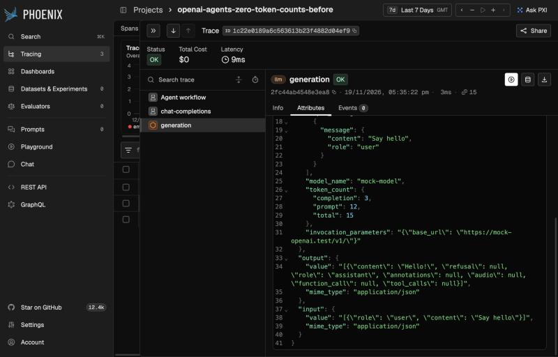
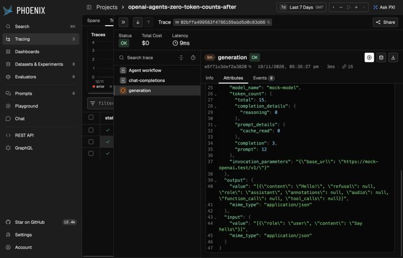

fixes #4185

Chat Completions spans from the openai-agents instrumentor now keep zero token counts, the same way Responses spans do.

### What was wrong

`_get_attributes_from_usage` (Responses path) emits `cache_read: 0` and `reasoning: 0` when there was no cache hit or no reasoning. `_get_attributes_from_chat_completions_usage` (the path for Gemini, Groq, OpenRouter, vLLM, LiteLLM) used `if x := ...` guards, so every 0 was dropped. Running the same agent on both paths gave different attribute sets, and filtering on `cache_read = 0` in Phoenix missed all the Chat Completions spans.

### The change

- Switched the guards to `is not None`, which matches the Responses path and the openai instrumentor (`_response_attributes_extractor.py`).
- One payload still gets skipped: when the provider returns no usage at all, the Agents SDK still records a default `Usage()` (every count 0, `requests: 0`), in both `OpenAIChatCompletionsModel` and `LitellmModel`. Emitting that would put made-up zeros on the span and skew cost numbers, so the helper returns nothing for it, same as today.

### Tests

- Updated the two parametrized cases that expected zeros to be dropped.
- Added `no_usage_from_provider` (the default `Usage()` payload -> no attributes) and `no_cache_hit_no_reasoning` (real zeros are kept).
- `tox run -e ruff-mypy-openai_agents,py313-ci-openai_agents` and `py313-ci-openai_agents-latest` (openai-agents 0.24.0) both pass, 348 tests.

### In Phoenix

Same agent on a mocked endpoint, run once on `main` and once on this branch ([script](https://raw.githubusercontent.com/DevammPatel/openinference/pr-assets/evidence/zero_token_counts.py)). The Chat Completions `generation` span:

| Before (main) | After |
|---|---|
|  |  |

Read back with `px span list`, token attributes on the LLM span of each run:

```
before  chat-completions           {prompt: 12, completion: 3, total: 15}
after   chat-completions           {prompt: 12, completion: 3, total: 15, prompt_details.cache_read: 0, completion_details.reasoning: 0}
both    responses-api              {prompt: 12, completion: 3, total: 15, prompt_details.cache_read: 0, completion_details.reasoning: 0}
both    chat-completions-no-usage  {}
```

Span tree and attribute values are identical between the two runs; the only difference is those two keys.

🤖 Generated with [Claude Code](https://claude.com/claude-code)
